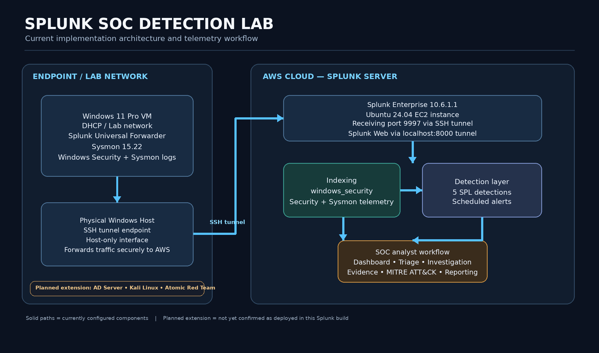

# Splunk SOC Detection Lab

A hands-on Windows endpoint monitoring and detection-engineering lab using Splunk Enterprise, Splunk Universal Forwarder, Windows Security events and Sysmon.

The project demonstrates an end-to-end workflow: collect endpoint telemetry, search and correlate events with SPL, save detection searches as alerts, build a monitoring dashboard, and document investigation findings.

## What this project demonstrates

- Windows Security and Sysmon telemetry collection in Splunk.
- SPL detections for failed authentication, authentication followed by success, account creation, group membership changes and PowerShell process creation.
- Scheduled alert configuration (the supplied screenshot documents the schedule for the Multiple Failed Logon alert).
- A SOC dashboard covering authentication, account activity, group changes and PowerShell execution.
- Evidence-based investigation notes with explicit caveats where the available data does not prove malicious activity.

## Lab architecture

The confirmed implementation uses Splunk Enterprise on Ubuntu 24.04 EC2 and a Windows 11 Pro VM running Splunk Universal Forwarder and Sysmon. The forwarding path uses the Windows host-only interface and an SSH tunnel to reach the Splunk receiver. Splunk Web is accessed through an SSH local tunnel.

The original design reference also included Active Directory Server, Kali Linux and Atomic Red Team. These are treated as planned extensions in the architecture, not as components verified in this implementation.

## Environment

| Component | Configuration |
|---|---|
| SIEM | Splunk Enterprise 10.6.1.1 on Ubuntu 24.04 EC2 |
| Endpoint | Windows 11 Pro VM |
| Log forwarder | Splunk Universal Forwarder |
| Endpoint telemetry | Sysmon 15.22 |
| Splunk index | `windows_security` |
| Windows Security sourcetype | `WinEventLog:Security` |
| Sysmon sourcetype | `XmlWinEventLog:Microsoft-Windows-Sysmon/Operational` |
| Receiving port | TCP 9997 (reached through the lab's private/tunneled path) |

Do not expose Splunk receiving port 9997, management port 8089 or the Splunk Web interface directly to the public internet.

## Detection engineering

The final SPL searches are in [`detections/`](detections/).

| Detection | Event source | Detection purpose |
|---|---|---|
| [Multiple failed logons](detections/multiple-failed-logons.spl) | Security 4625 | Finds 5 or more failures for an account in a 10-minute bucket, grouped by host and source IP. |
| [Failed then successful logon](detections/failed-then-successful-logon.spl) | Security 4624, 4625 | Finds at least 5 failures and at least 1 success for the same account in a 10-minute bucket. |
| [New user account created](detections/new-user-account-created.spl) | Security 4720 | Extracts the account creator and newly created account. |
| [Group membership change](detections/privileged-group-membership-change.spl) | Security 4728, 4732, 4756 | Finds additions to security-enabled global, local or universal groups. Analysts must inspect the actual group. |
| [PowerShell process execution](detections/powershell-process-execution.spl) | Sysmon 1 | Extracts PowerShell process image and command line. Execution alone is not proof of malicious activity. |

## Validation results observed

The attached screenshots show the following historical lab results:

- **Multiple failed logons:** 3 qualifying groups — 5 failures for `SOC_TestUser`, another 5 for `SOC_TestUser`, and 8 for `SOC_LabCreated`.
- **Failed then successful logon:** 2 qualifying groups for `SOC_TestUser`, each with 5 failures and 1 success in the same 10-minute bucket.
- **New account creation:** 2 matching Event ID 4720 events; the displayed event shows actor `beezl` creating `SOC_LabCreated`.
- **Group membership:** 5 matching events; a displayed Event ID 4732 shows a member added to the built-in `Administrators` group by `beezl`. The member account name is not resolved in the screenshot; the member SID is present in the event.
- **PowerShell:** 117 matching Sysmon process-creation events in the all-time search shown. The results include PowerShell command lines for inspection.

These are lab observations, not evidence of a real-world compromise. In particular, the authentication correlation is based on co-occurrence in a 10-minute bucket and does not establish event order or causation.

## Scheduled alert

Five named SOC alert searches were created for the detections above. The evidence package includes the configuration view for **SOC - Multiple Failed Logon**, which visibly shows:

- Alert type: Scheduled.
- Cron expression: `*/5 * * * *` (runs every five minutes).
- Search time range: Last 10 minutes.

The supplied screenshot does not show trigger actions, severity, throttling or expiration settings. Those settings are intentionally not asserted in this documentation. See [`alerts/alert-configuration.md`](alerts/alert-configuration.md).

## Dashboard

The dashboard is named **SOC Security Monitoring Dashboard**. It contains KPI panels for indexed events, failed and successful logons, new accounts, privileged group changes and PowerShell executions, plus time-series and event-detail panels. The captured PDF is included at [`screenshots/dashboard/11-soc-security-monitoring-dashboard.pdf`](screenshots/dashboard/11-soc-security-monitoring-dashboard.pdf).

The PDF snapshot shows 41,861 total indexed events, 27 failed logons, 390 successful logons, 2 new user accounts, 5 privileged group changes and 66 PowerShell executions for the selected Last 24 hours view. These are time-dependent snapshot values, not fixed performance metrics.

## Repository guide

- [`architecture/`](architecture/) — lab architecture and source design reference.
- [`configuration/`](configuration/) — environment, forwarding and time notes.
- [`detections/`](detections/) — final SPL searches.
- [`alerts/`](alerts/) — documented alert configuration evidence.
- [`dashboard/`](dashboard/) — dashboard description and panel inventory.
- [`investigations/`](investigations/) — five investigation reports based on captured lab evidence.
- [`limitations/`](limitations/) — telemetry and interpretation caveats.
- [`screenshots/`](screenshots/) — curated screenshots grouped by evidence type.

## Known limitations

- Sysmon Event ID 255 recorded driver queue overflow and dropped events during the lab; telemetry completeness was affected during that period.
- The EC2 host uses UTC while Windows uses India Standard Time (UTC+05:30). Preserve timezone context when correlating events.
- The failed-then-successful detection aggregates events into 10-minute buckets. It does not prove that the successful logon followed the failures.
- The group membership search covers additions to security-enabled groups generally. Confirm the group and authorization before treating an event as privileged or suspicious.
- PowerShell is a legitimate administration tool. Investigate command line, parent process, user, host context and surrounding activity before assigning malicious intent.
- The confirmed Splunk implementation is centered on one Windows 11 Pro endpoint; no Active Directory domain controller deployment is claimed here.

## Analyst approach

A detection match is a lead for investigation, not a verdict. Validate the raw event, identify the actor and affected object, establish whether the activity was expected, correlate surrounding telemetry, and document any remaining uncertainty before recommending containment.
